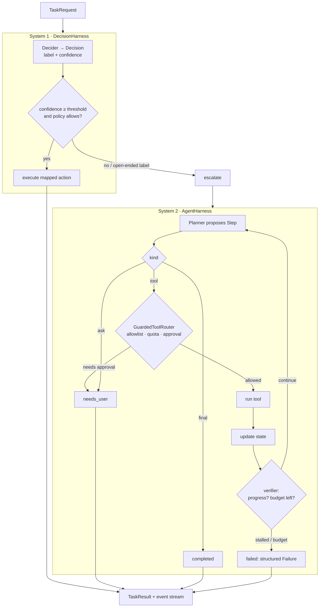

# System 1 vs. System 2 agent harnesses

A small, runnable reference for the two ways to put a model inside an application, and for how to run both behind one task contract.

| | **System 1 harness** | **System 2 harness** |
| --- | --- | --- |
| Model's job | Make one bounded judgment (a category, route, score or field) | Plan the next step toward a goal |
| Output | Typed, from a finite set supplied by code | A proposed step: tool call, final answer, or question |
| Who owns the workflow | Application code (confidence gate + policy, then execute or escalate) | Application code (guarded tool router, budgets, stop conditions, final execution) |
| Good for | Intent classification, model routing, risk gates, reranking, high-volume decisions | Coding, research, incident or billing investigations, multi-step dependent work |

The difference is **control flow**, not model size. In both harnesses the model has influence but no authority: permissions, budgets, stop conditions and side effects stay in code. Most production apps need both, so `AppRouter` sends every request to System 1 first and hands anything it escalates to System 2 **with the same request object and the same event/result types**.

Standard library only. No API keys are needed to run the demo or tests.

## Architecture



## Code map

```
system1-system2-harness/
├── harness/
│   ├── protocol.py      The shared contract: TaskRequest, TaskEvent (streamed), TaskResult
│   │                    (completed | needs_user | escalated | failed) and a structured Failure.
│   ├── system1.py       DecisionHarness: calls a Decider for a typed Decision, applies the
│   │                    confidence gate and per-label policies, then runs the mapped action or
│   │                    escalates. NaiveBayesDecider is a dependency-free stand-in decision model.
│   ├── system2.py       AgentHarness: the plan → guarded call → state → verify loop.
│   │                    GuardedToolRouter enforces the allowlist, per-tool quotas and
│   │                    approval-required tools. ScriptedPlanner (deterministic) and the optional
│   │                    OpenAIPlanner (any OpenAI-compatible endpoint, JSON-only output) plug in.
│   └── app_router.py    AppRouter: System 1 first; on escalation, System 2 with the same request.
├── examples/
│   └── support_desk.py  A billing desk: four System 1 labels (password reset, refund with an
│                        auto-approve limit, plan question, investigate) and three System 2 tools
│                        (get_invoices, get_plan_changes, issue_credit — approval required).
├── demo.py              Runs five requests end to end and prints every event.
└── tests/test_harnesses.py
```

How the pieces fit: the decision model and the planner are plug-ins with narrow interfaces (`decide()` → `Decision`, `next_step()` → `Step`). Everything that can cause a side effect goes through code the application controls: `DecisionHarness.actions` for System 1 and `GuardedToolRouter` for System 2. Both return the same `TaskResult`, so callers never branch on which harness ran.

## What the demo shows

```bash
python demo.py
```

1. `"reset my password please"`: System 1, high confidence, action runs.
2. `"please refund my last order"` for **$40**: System 1 runs the refund.
3. The same text for **$400**: the refund policy blocks it, so the request escalates to System 2, which asks for the missing account.
4. `"why did my invoice double last month?"`: System 1 labels it `investigate` (an open-ended intent), so System 2 reads invoices, then plan changes, finds a reverted upgrade and proposes `issue_credit`. The router **stops and asks for approval** instead of running it.
5. The same request with `approved={"issue_credit"}`: the credit runs once (quota = 1) and the harness returns a final answer.

Tests (`pytest -q`) also cover a planner that asks for a tool not on the allowlist (blocked every step until the budget runs out), a loop that makes no progress (stopped by the verifier), per-tool quotas, invalid decision-model output, and tool exceptions returned as data rather than crashes.

## Run

```bash
python -m venv .venv && source .venv/bin/activate
pip install -r requirements.txt
python demo.py
pytest -q
```

### Using a real LLM as the System 2 planner (optional)

```bash
pip install openai
export OPENAI_API_KEY=...            # or OPENAI_BASE_URL=https://openrouter.ai/api/v1 plus that key
export PLANNER_MODEL=gpt-4.1-mini
```

```python
from harness.system2 import AgentHarness, OpenAIPlanner
from examples.support_desk import TOOLS
agent = AgentHarness(OpenAIPlanner(), TOOLS, constraints=["ask before side effects"])
```

Anything the model returns that is not valid JSON becomes an `ask` step, so bad output can never trigger a tool call. To use a real decision model in System 1, implement `decide(text, state) -> Decision` over a fixed label set: a fine-tuned classifier, a small encoder, or an LLM constrained to an enum.

## Related open-source work

- [HarnessRouter](https://github.com/HarnessRouter/harnessrouter) is a production infrastructure layer that runs System 1 decision models and agent runtimes (Codex, Claude Code, Hermes and others) behind a single Unified Harness Protocol. `protocol.py` here is a deliberately tiny illustration of the same idea: one contract for starting tasks, streaming progress and reporting structured failures.
